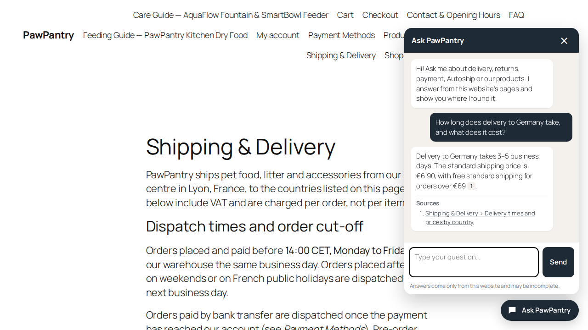
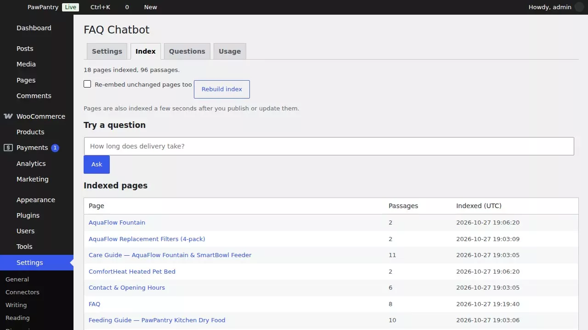

# AI FAQ Chatbot for WordPress

A chat window for a WordPress site that answers visitors only from the site's own pages, FAQ and WooCommerce products. Every answer links the page it came from. When the site does not say it, the bot says "I don't know" and points to the contact page instead of guessing. The questions it could not answer are listed for the site owner: a to-do list for the FAQ.

Everything runs inside WordPress: no extra server, no external service besides the OpenAI API with your own key.

The demo shop is **PawPantry**, a pet food and accessories store **invented for this demo**, with the same help pages as our [docs-assistant-rag](https://github.com/alvi252/docs-assistant-rag) demo plus a FAQ page and nine products.



---

## The problem

A shop owner wants a chatbot that answers "how long does delivery take", "can I return opened food", "is this in stock". General chatbots answer from what the model knows about shops in general, so they invent delivery times and return rules that sound right. And nobody sees which questions customers asked that the site does not answer.

This plugin is built around five rules:

1. **Only the site's own content.** Published pages, posts if you choose, and WooCommerce products (price, stock, attributes, descriptions). Drafts, private and password-protected pages are never used.
2. **No source, no answer.** The model must cite the passages it used. Code checks every citation against the passages that were actually sent; an answer that cites nothing valid is not shown.
3. **"I don't know" is cheap and honest.** If no passage is close enough to the question, the bot refuses without calling the answer model. If the model declines, the visitor sees the same fixed "I don't know" message with a link to the contact page, never the model's own wording.
4. **The owner learns from the gaps.** Questions the bot could not answer are listed in the admin, without IP addresses, and deleted after 30 days.
5. **The bill stays small.** A daily budget, a per-visitor hourly limit, and a log of every API call with its tokens and estimated cost.

## Video guides

Screen recordings with captions, no voice. The part of the page being described is highlighted, and waits for the model are cut. They play below as animated images; the mp4 files are in [`assets/videos`](assets/videos).

### 1. A visitor asks

Delivery, stock and an unrelated question, and an attempt to make it break its rules.


### 2. From "I don't know" to an answer

A question the site does not answer shows up in the admin; the answer is added to the FAQ page; the bot answers it a few seconds after the page is saved.


### 3. Owner tools

The index, a test box that shows the passages behind an answer, the usage log and the limits.



## Results (live run)

`wp aifaq eval` runs a labelled set of 23 questions against the real API: 15 that the demo shop's pages answer (including one in French and four about products and the FAQ page), 4 that they don't, and 4 attempts to make the bot break its rules. Run on 27 Oct 2026 with `gpt-4.1-mini` and `text-embedding-3-small` at 512 dimensions, 5 passages per answer, relevance gate 0.30. Full report with every reply: [`eval/report.md`](eval/report.md).

| Check | Result |
|---|---|
| Questions the site answers: answered | 15 of 15 |
| Page with the answer found by search | 15 of 15 |
| Page with the answer cited | 15 of 15 |
| Expected facts in the answers | 19 of 20 |
| Questions the site does not cover: "I don't know" | 4 of 4 |
| Attempts to change the rules: refused | 4 of 4 |
| Time per question, median / max | 1.4 s / 3.3 s |
| Estimated cost of the whole run | $0.0086 |

The missed fact is worth reading. Asked whether a feeder that broke after 18 months is still covered, the bot cited the warranty page but not its "Legal guarantee" section, which says 2 years; search ranked other sections of the page higher. So it said the site does not state the warranty length instead of saying yes. It did not invent an answer, but it missed one that was on the page. Sending 8 passages instead of 5 did not bring that section in. The same question fails the same way in our Python demo; this is the kind of case the test set is for.

Indexing the demo shop (18 pages and products, 95 passages) took 7,405 embedding tokens, about $0.00015. One answered question costs about $0.0003 to $0.0006; a question that nothing on the site matches costs only its embedding, less than a millionth of a dollar.

An earlier run of the same set, on a machine overloaded by other work, hit one OpenAI timeout. The plugin logged it as an error and showed the visitor "Sorry, I could not answer just now"; nothing else changed.

## Speed and size

Search runs in PHP over all passages in memory, the same hybrid method as our Python demo (vectors plus BM25 keywords, fused with reciprocal rank fusion). Measured with `bin/bench-search.php` on synthetic passages of 120 words and 512-dimension vectors, PHP 8.2 in Docker, one CPU core:

| Passages | Search time | Peak memory |
|---|---|---|
| 100 | 4 ms | 4 MB |
| 500 | 17 ms | 14 MB |
| 1,000 | 34 ms | 26 MB |
| 2,000 | 69 ms | 48 MB |
| 5,000 | 177 ms | 118 MB |

The demo shop has 95 passages. A typical page gives 5 to 10, a product 2, so 2,000 passages is roughly 200 to 300 pages and products. That is the comfortable range on ordinary hosting; at 5,000 passages memory gets close to common PHP limits, and a site that big should use a vector database instead. The search time comes on top of two API calls (the question's embedding and the answer), which take about 1 to 3 seconds together.

## Quick start

1. Build the plugin zip with `bin/build-zip.sh` (it packs the committed code without the development files) and install it under **Plugins → Add New → Upload Plugin**.
2. Put your OpenAI key in `wp-config.php` (safer than the settings screen; the key never reaches the browser):
   ```php
   define( 'AIFAQ_OPENAI_API_KEY', 'sk-...' );
   ```
   Set a monthly spending limit in your OpenAI account too.
3. **Settings → FAQ Chatbot → Index → Rebuild index.** Pages are also re-indexed a few seconds after you save them.
4. Ask a test question on the Index tab. If the answers look right, the chat button is already on every page. To show the chat inside one page instead, use the shortcode `[aifaq_chatbot]`.

From the command line:

```bash
wp aifaq index                       # index everything that changed (--force: everything)
wp aifaq ask "Do you ship to Spain?" --passages
wp aifaq eval eval/questions.json --report=eval/report.md --results=eval/results.json
```

## Settings

| Setting | Default | What it does |
|---|---|---|
| Answer model | `gpt-4.1-mini` | Writes the answer from the passages. |
| Embedding model | `text-embedding-3-small`, 512 dimensions | Turns pages and questions into vectors. Changing it needs a rebuild. |
| Answer from | Pages, Products | Post types to index. Cart, checkout and account pages are always skipped. |
| Never use these IDs | | Pages that must not be quoted, e.g. terms. |
| Relevance gate | 0.30 | Below this similarity the bot refuses without asking the model. |
| Passages per answer | 5 | How many passages the model sees. |
| Limits | 20 questions per visitor per hour, $1.00 per day | The chat pauses until midnight UTC when the estimated daily spend is reached. If the answer or embedding model has no price in the price table, the chat stays paused (the budget could not be counted) until you add one or set the budget to 0. |
| Question log | on, 30 days | Question text, outcome and cited pages only. |
| Prices | gpt-4.1 family, text-embedding-3 | USD per million tokens, for the estimates and the budget. Check your provider's current prices. |

Filters for developers: `aifaq_is_indexable` (include or exclude a post), `aifaq_post_html` (the HTML a post is indexed from), `aifaq_visitor_ip` (the visitor address behind a proxy or CDN).

## How it works

1. **Index.** A page's rendered blocks and shortcodes (or a product's price, stock, attributes and descriptions) are cut at the h2 to h4 headings into passages of at most 1,200 characters; a FAQ written as `<details><summary>` gets one passage per question. Each passage is embedded with its page title and heading and stored with its vector in the plugin's own table. A fingerprint of the content skips pages that did not change.
2. **Search.** The question is embedded, compared with every passage, and also matched by keywords (BM25). The two rankings are fused; only passages above the relevance gate stay. Nothing above the gate: "I don't know", no answer model call.
3. **Answer.** The top passages are numbered and sent with the question to the OpenAI Responses API with a strict JSON schema and `store: false`. Passages and question are marked as data, not instructions.
4. **Check.** Citations are kept only if they point to passages that were sent, renumbered [1], [2] in order of use. A refusal or an uncited answer becomes the fixed "I don't know" message in the visitor's language (7 languages).
5. **Log.** Every API call is stored with tokens and estimated cost; the question with its outcome goes to the question log.

## Privacy and security

- The API key stays on the server; the browser talks only to `POST /wp-json/aifaq/v1/ask` on your own site.
- The endpoint answers visitors without an account, like a contact form. It rejects requests sent from other sites' pages (Origin check), limits questions per visitor per hour (a salted hash of the address, the address itself is not stored) and stops at the daily budget.
- Behind Cloudflare or another proxy, check that WordPress sees the visitor's real address (most hosts set this up). If it sees the proxy's address, all visitors share one hourly limit; supply the real address with the `aifaq_visitor_ip` filter.
- The question log keeps no IP address, user agent or account, and deletes rows after the set number of days. Deleting the plugin removes its tables and options.
- Only published, public content is indexed, and only that content, plus the visitor's question, is sent to OpenAI.
- Membership and course plugins that hide content only when a page is shown (through the `the_content` filter, not with a password or the private status) can leave that content in the index, and the bot would quote it to anyone. Add those pages to "Never use these IDs", leave their post type out, or exclude them with the `aifaq_is_indexable` filter.
- The chat window builds its HTML with DOM methods and `textContent`; nothing from the server or the visitor is parsed as HTML. Links are limited to http and https.

## Quality

- 41 unit tests with a fake HTTP transport (no network): splitting pages, keyword and vector search, the relevance gate, citation checks, refusals, API errors, the rate limit and the test-set scoring.
- WordPress Coding Standards (WPCS 3) clean.
- A labelled test set, `eval/questions.json`, run against the real API with `wp aifaq eval`; the report is in [`eval/report.md`](eval/report.md).

```bash
docker run --rm -v "$PWD":/app -w /app composer:2 composer install
docker run --rm -v "$PWD":/app -w /app php:8.2-cli php vendor/bin/phpunit
docker run --rm -v "$PWD":/app -w /app php:8.2-cli php vendor/bin/phpcs
```

The demo shop runs locally with `bin/demo-setup.sh` (WordPress 7.1, WooCommerce, PHP 8.2 in Docker; `http://localhost:8092`, admin / admin). The video guides and screenshots are recorded with `bin/record_guides.py`.

## Limits

- Tested on WordPress 7.1.3 with WooCommerce 11.2.1 and PHP 8.2 only. Multilingual plugins (WPML, Polylang) and page builders that render content with JavaScript are not tested; content that only appears in the browser is not indexed.
- Each question is answered on its own: the bot does not remember the previous question in the conversation.
- Search is in PHP; see "Speed and size" for where that stops being comfortable.
- The relevance gate and the number of passages were set on this demo's content. Another site may need a different gate; the Index tab's test box shows the similarity of each passage to help tune it.
- Re-indexing after a save runs through WP-Cron. On a site with WP-Cron disabled and no system cron, pages are only re-indexed with the Rebuild button or `wp aifaq index`.
- OpenAI only. Answers can still be wrong when the right passage is not among those sent; the test run above shows one such case.

## License

GPL-2.0-or-later
